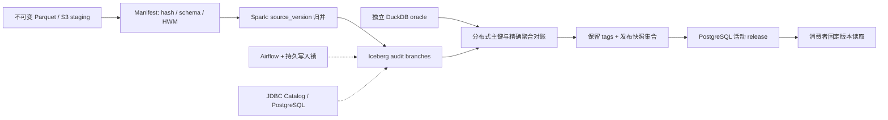

# LakeBridge · 历史数据湖仓迁移与性能治理

[English README](README.md)

将不可变的历史 Parquet 与追加批次迁移到 Apache Iceberg，用 PySpark 完成版本归并、
范围补数、独立对账和快照发布。消费者读取同一 release 绑定的明细、套餐、汇总快照；
错误发布可以切回旧版本，再前向修正并保留后续合法数据。

本项目按《03_LakeBridge_历史数据湖仓迁移与性能治理》实现。验收以真实运行证据为准：
小样本业务闭环及本机三 Worker 的 10.157 GiB 存储/性能模拟已运行，并提供明确假设的云费用估算。
50–100 GiB、10 GiB SaaS 业务全流程和真实云端账单实验尚未执行。
详细结果见 [验收记录](docs/acceptance.md)。

2026-09 工程更新：修复 PostgreSQL 发布/回滚竞争与重复请求边界，增加无 Spark 的只读审计指标，
升级到 Spark 3.5.9 / Iceberg 1.10.2。依据、范围与证据见
[工程取舍](docs/design-decisions.md)、[本轮验证](docs/market-refresh-validation.md)。



## 快速运行

需要 Python 3.11、JDK 17、uv；首次安装需要下载 Python/JVM 依赖。Linux/macOS 单机可使用
本地 Hadoop Catalog + SQLite 审计，仍运行真实 Spark 和 Iceberg，适合快速复现。

```bash
cd LakeBridge
export JAVA_HOME=/path/to/jdk17
make install
make test
make integration

# 每次完整 demo 使用新的 root 和 namespace；避免覆盖已有演示数据。
.venv/bin/lakebridge --root artifacts/my_demo --namespace my_demo demo --rows 200 --days 14
.venv/bin/lakebridge --root artifacts/my_demo --namespace my_demo query --limit 5
```

设置 `JAVA_HOME` 为本机实际安装的 JDK 17 路径。
`make install` 使用 `uv.lock` 冻结依赖，并校验 JVM jar 的仓库内固定 SHA-256。
项目不能写入原始数据路径与仓库路径相互包含的目录。

## PostgreSQL + MinIO 完整环境

```bash
mkdir -p artifacts
docker compose up -d postgres minio minio-init
docker compose build spark
docker compose run --rm spark --root /workspace/artifacts/compose compatibility
docker compose run --rm spark --root /workspace/artifacts/compose demo --rows 200 --days 14
docker compose run --rm spark --root /workspace/artifacts/compose query --limit 5
```

新 checkout 不包含生成数据；完成 demo 后，结果保存在 `artifacts/compose`，再执行查询命令。
重复 demo 需要独立的 catalog/audit 数据集，不能只更换输出目录重用同一审计库。
每个审计 schema 绑定一个 namespace/warehouse，避免读写串库。

| 服务 | 本机地址 | 开发凭据 |
|---|---|---|
| PostgreSQL | `127.0.0.1:55439` | catalog: `lake_catalog/catalog_local`；审计: `lake_audit/audit_local` |
| MinIO API / Console | `127.0.0.1:59000` / `http://localhost:59001` | 管理员 `minio_admin/minio_admin_local` |
| Airflow（可选） | `http://localhost:58080` | `admin/admin_local` |

开发凭据只用于本地实验。Compose 端口只绑定回环地址；catalog 和 audit 使用不同 schema/角色，
湖表 writer 仅有 warehouse bucket 权限，不能删除 raw bucket 文件。
端口冲突时设置 `LAKEBRIDGE_POSTGRES_PORT`。停止服务并保留数据：`docker compose --profile airflow down`。
数据卷清理、云资源退出步骤见 [基础设施说明](infra/README.md)。

MinIO 仓库已归档、Airflow 2.x 已结束支持；上述配置保留为历史本地实验，不能作为生产部署推荐。
此次执行锁协议更新需停止旧作业后统一切换，不支持旧镜像与新代码混跑；见 [版本说明](docs/versions.md)。

## 分步骤迁移和补数

```bash
.venv/bin/lakebridge generate --output artifacts/source --rows 3000 --days 90
.venv/bin/lakebridge verify-manifest artifacts/source/manifest.json --watermark 1
.venv/bin/lakebridge --root artifacts/local migrate \
  --manifest artifacts/source/manifest.json --watermark 1 --rule v1 \
  --run-id initial_h0 --reason '固定 H0 全量迁移'

.venv/bin/lakebridge --root artifacts/local dry-run \
  --manifest artifacts/source/manifest.json --watermark 2 --rule v1 \
  --start 2025-01-01 --end 2025-03-31
.venv/bin/lakebridge --root artifacts/local backfill \
  --manifest artifacts/source/manifest.json --watermark 2 --rule v1 \
  --start 2025-01-01 --end 2025-03-31 --run-id late_h1 --reason '迟到修订追赶至 H1'
.venv/bin/lakebridge --root artifacts/local releases
.venv/bin/lakebridge --root artifacts/local query --release rel_initial_h0 --limit 5
```

生成器第 2 批包含分布在历史日期中的迟到修订；必须先覆盖这些修订才能把输入边界推进到 H1。
消费进度按到达批次推进。相同键的同版本冲突会隔离并阻断；较旧版本不能复活已删除事件。
第一次迁移要求全范围。详细说明见 [数据契约](contracts/README.md) 与 [补数手册](docs/backfill.md)。

## 故障、恢复与维护

```bash
# 注入“数据已提交但发布审计未写完”的故障；返回非零符合预期。
.venv/bin/lakebridge --root artifacts/local migrate \
  --manifest artifacts/source/manifest.json --watermark 3 --rule v1 \
  --run-id failure_demo --reason '审计间隙演练' --fail-at before_audit
.venv/bin/lakebridge --root artifacts/local recover failure_demo

# 只切消费者；写入表头保留，后续通过前向修正保住合法新增。
.venv/bin/lakebridge --root artifacts/local rollback rel_initial_h0 --reason '消费者回退演练'
.venv/bin/lakebridge --root artifacts/local maintain inspect
.venv/bin/lakebridge --root artifacts/local maintain orphans
.venv/bin/lakebridge --root artifacts/local maintain compact --execute
```

锁没有自动过期，失败运行必须 recover 或满足条件后 abort；不能让“租约时间到了”成为新写者
越过旧提交的依据。Airflow 用单作业涵盖建分支至发布的临界区。此控制只约束本项目写入者，
外部写入者必须实际停用；不声称 JDBC/应用锁已经实现存储层提交 fencing。

使用 `lakebridge --root ... --namespace ... status` 查看只读审计快照，
或 `metrics --output artifacts/metrics/lakebridge.prom` 导出监控文件。
采集失败返回非零并输出 `audit_up 0`；指标语义、采集新鲜度及恢复步骤见 [监控手册](docs/observability.md)。

## 编排与性能证据

```bash
export AIRFLOW_UID=$(id -u)
docker compose --profile airflow build airflow
docker compose --profile airflow run --rm airflow-init  # 首次初始化
docker compose --profile airflow up -d airflow

.venv/bin/lakebridge --root artifacts/performance --namespace performance \
  benchmark --rows 100000 --repetitions 3 --file-mib 128
```

Airflow DAG `lakebridge_history` 接受 manifest、watermark、rule、start/end、reason，
依次校验输入、生成 dry-run、写入/对账/发布、验证消费者。DAG `lakebridge_maintenance` 默认只输出计划。
已有 Compose 演示数据的继续处理可使用 `/workspace/artifacts/compose/source/manifest.json`，
HWM 3、规则 v1。首次独立编排数据集应配置独立审计 schema 与 namespace。

性能实验比较旧 Parquet、无分区 Iceberg、日期分区 Iceberg，以及同一表合并前后；每项至少 3 次。
运行产出 report.json、report.md、EXPLAIN 与实际 SQL metrics；Spark event logs 记录任务级 shuffle、spill、GC。
方法与限制见 [性能实验](benchmarks/README.md)，实际结果见 [验收记录](docs/acceptance.md)。

四项演示的真实终端录屏在 [demo.cast](docs/evidence/demo.cast)，安装 asciinema 后运行
`asciinema play docs/evidence/demo.cast` 回放；它由 `scripts/record_demo.py` 记录实际执行时序。

历史 Spark 3.5.6 / Iceberg 1.8.1 环境的本机多 Worker 模拟已实跑 19,773,338 条合成宽事件、压缩后 10.157 GiB，全部精确对账通过。
文件合并从 720 个文件降至 90 个，全量查询中位时间 9.715 → 8.407 秒。
复现命令见 [本地模拟](docs/local-simulation.md)，实测与费用假设见
[10 GiB 报告](docs/performance-local-10g.md)。模拟环境独立于原演示数据卷。

## 代码与文档

| 目录 | 内容 |
|---|---|
| src/lakebridge | 可安装的 CLI、Spark 作业、控制状态机、oracle、维护、实验 |
| source-adapters / contracts / examples | 生成器、S3 adapter、输入契约、真实样例 manifest/Parquet |
| spark-jobs / sql / validation | 作业入口说明、固定查询、独立验收 |
| orchestration / infra | Airflow DAG、Docker、Terraform S3/IAM 实验模块 |
| tests / .github/workflows | 单元与真实 Spark 集成测试、CI 证据上传 |
| benchmarks / docs | 方法、实测报告、迁移/补数/切换/恢复/保留手册 |

阅读顺序：[架构与迁移](docs/migration.md) → [补数](docs/backfill.md) →
[切换与回退](docs/cutover-rollback.md) → [保留与维护](docs/retention.md) →
[并发复盘](docs/concurrency-postmortem.md) → [验收](docs/acceptance.md)。
