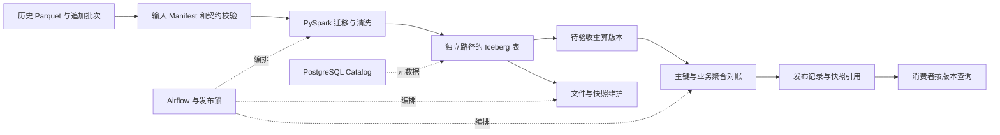

**LakeBridge｜历史数据湖仓迁移与性能治理**

项目方向文档 v1.0 · 2026-09-06 · 建议仓库名：`lakebridge`

**项目定位。** 将按日期目录存储的历史 Parquet 数据迁移到 Apache Iceberg，通过 PySpark 建立可校验、可重算、可发布、可恢复的历史数据处理流程，并用执行计划和实测结果完成性能与存储治理。适合展示 Spark、湖仓、批处理、数据迁移、补数和生产变更能力。

本文件为待实施设计，尚未取得性能或成本收益。项目先测出旧方案的问题，再验证迁移和优化是否值得；最终结果允许出现某项没有提速或维护成本增加，并解释原因。

**生产场景。** 假设公司保存了多个账期的 SaaS 用量和客户套餐历史，数据来自不可变批次文件。随着业务演进，团队需要重算历史套餐归属、修复错误用量、增加分析字段，同时让日常数据继续接入。旧流程直接覆盖日期目录，难以确认读者看到哪个版本，失败补数也可能留下不完整结果。

主数据可以使用 LedgerFlow 的原始用量与维度变更记录；本项目必须同时提供独立生成器和样例 manifest，因此不依赖 LedgerFlow 已完成。AdPulse 的广告事件可作为后续第二种输入，通过单独 adapter 接入，不在第一版混用两套业务主键和口径。

| 使用者 | 工作中的需求 | 本项目交付 |
| --- | --- | --- |
| 分析师 | 某段历史数据修正后，结果为什么与上周不同？ | 可追溯的数据发布版本和快照引用 |
| 业务运营 | 套餐规则修复后重算 30／90 天，不能漏客户 | 受影响范围清单、重算结果和业务对账 |
| 数据平台团队 | 批处理变慢、文件过多、存储增长 | 执行计划、文件统计与有证据的维护策略 |
| 值班 DE | 错误更新上线后如何恢复？ | 明确写入边界的切换、回退与验证流程 |

典型需求：“现有用量计算规则有一处历史错误，需要重算最近 30 天；当天新增数据继续落到原始层。切换前核验业务主键和聚合，切换后还能解释旧报表所用的数据版本。”

**技术栈与职责。**

| 层次 | 选型 | 具体用途和取舍 |
| --- | --- | --- |
| 分布式计算 | Apache Spark、PySpark、Spark SQL | 历史读取、清洗、关联、MERGE、重算、对账和文件优化 |
| 湖表格式 | Apache Iceberg | 表级快照、版本读写、schema／分区演进与维护 |
| 数据文件 | Parquet | 旧数据基线和新湖表的数据文件格式，便于控制比较变量 |
| 对象存储 | Amazon S3；本地可用兼容存储 | 原始文件与湖表文件使用不同前缀和权限 |
| Catalog | Iceberg JDBC Catalog + PostgreSQL | 初版统一表元数据提交入口；依赖版本、JDBC 驱动在集成阶段冻结 |
| 编排 | Apache Airflow | 迁移、日期范围重算、质量检查、维护和发布流程 |
| 控制数据 | PostgreSQL 发布／运行审计表 | run_id、规则版本、manifest、输入进度、表快照与发布状态 |
| 观测 | Spark UI、event logs、SQL explain、Iceberg metadata tables | shuffle、spill、倾斜、文件数量、扫描量和执行耗时 |
| 工程交付 | Docker Compose、GitHub Actions、Terraform | 本地环境、CI、云端实验和资源清理 |

第一版用 Spark SQL 自身完成查询和验收，避免同时维护多套查询引擎。只有明确需要服务其他消费者时再接 Trino／Athena，并增加跨引擎兼容测试。若目标 JD 明确 Databricks/Delta，可将本专项实现替换为该技术组合；本方向的验收方法仍保留。

版本冻结记录 Spark 版本、Scala 二进制版本、Iceberg runtime artifact、catalog、对象存储 FileIO 与必要扩展。建表成功不等于 MERGE、分支、维护和恢复都可用，首阶段分别做小型兼容验证。

JDBC Catalog 将表的元数据位置管理建立在关系数据库事务能力上；本项目的 PostgreSQL catalog 库与运行审计可放在同一服务的不同 schema，使用不同角色并分别备份。具体连接配置按冻结版本核验。[Iceberg JDBC Catalog](https://iceberg.apache.org/docs/latest/jdbc/)

**架构与数据发布。**

源端历史 Parquet 不直接变为可删除的湖表底层文件。第一版采用“读旧文件、写到独立 Iceberg 路径”的迁移方式，避免旧任务和新维护流程共同拥有一批文件。物理复制成本需要计入迁移预算，不能只计算后续查询收益。

**数据契约、模型与规模。**

| 对象 | 粒度／字段 | 约束 |
| --- | --- | --- |
| 原始用量事件 | tenant_id、event_id、event_time、ingested_at、units、source_version | 同业务键的修订有可排序源版本；相同版本不同内容要隔离 |
| 套餐历史 | tenant_id、plan_id、effective_from、effective_to、attributes | 时间区间清晰、无不合法重叠 |
| 迁移明细表 | 一条用量事件的当前有效业务版本 | 源重复先归并，保留来源与处理规则版本 |
| 日汇总表 | tenant_id、business_date | 与对应明细快照和维度快照一致 |
| 输入 manifest | 文件路径、内容摘要、字节数、行数、schema、批次进度 | 文件到齐且校验后才可处理，晚到文件单独形成新批次 |
| 发布记录 | release_id、表名与 snapshot_id 集合、rule_version、input_high_watermark | 完成验收后可用，消费者能解析具体数据版本 |
| 运行记录 | run_id、输入清单、Spark application_id、输出提交状态 | 失败恢复能确定“没提交”还是“提交了但审计没写完” |

源版本用于处理修订和删除事件，不能把 event_time 当修改版本。模拟逻辑删除可用带版本的 tombstone；较旧更新不能覆盖更新版本的删除状态。初版金额／用量使用明确精度，生成器保存独立预期结果。

建议分三个实验档位：小样本用于 CI；约 10 GB 用于完整功能与初步基线；资源允许再做 50–100 GB 的倾斜和优化实验。报告同时记录压缩存储大小、记录数、事件分布和实际扫描量。通过多租户、季节性、热点客户、迟到修订和多账期变化扩展数据，不机械复制同一批记录。

**从旧流程迁移到新表的具体步骤。**

1. 冻结输入契约与基线查询，列出哪些目录、文件和日期属于本次迁移，生成带摘要的 manifest。全量期间新数据继续进入原始层的后续批次。
2. 记录初始输入边界 H0，读取截至 H0 的明确文件集合并写入独立目标表。源端未提供不可变文件或可重复快照时，先解决读取一致性。
3. 校验主键集合、重复数、空值、日期范围和按 tenant/date 的业务聚合，并对失败记录输出明细。相同总行数不能代替主键集合检查。
4. 按原始批次进度追赶 H0 之后的输入，合并更新和删除。进度基于到达批次／源版本，不能只按事件日期判断，因为今天可能收到上个月的修订。
5. 在短暂切换窗口取得写入租约，记录最终输入边界 H1；将目标追赶到 H1 并再次对账。原始采集继续，新的下游发布可以等待。
6. 写入待发布记录，绑定目标表及 snapshot_id；消费者切换到新 release，新的写入者确认发布代次后路由到新目标。初版实际停用旧写入任务，并等待在途提交结束或将其终止后才切换；仅在写入前查询一次租约不足以防止过期写入者提交，进阶 fencing 需在提交边界真正强制执行。
7. 保留旧路径、旧发布配置和对账结果至回退窗口结束。切换后验证样例查询与最新批次到达，满足退出条件后再退役旧任务。

发布代次／租约是本项目控制层设计。Iceberg 的单表原子提交不能自动替你协调原始文件、catalog、Airflow 审计和多个消费者。跨表发布使用清单绑定每张表的快照，消费方按发布清单读取，不能把连续两次单表提交描述为跨表事务。[Iceberg 表格式规范](https://iceberg.apache.org/spec/)

**历史补数与并发写入。** 业务方指定日期范围、规则版本和原因后，先用 dry-run 输出受影响分区、业务键范围和输入边界。输出数据先验收后发布，规则版本、维度快照和输入快照一起固定。

初版采用单表串行发布策略：需要用 audit branch 修正某表时，对该表从建分支到验收发布期间加写入锁；原始接入继续，其他表可运行，被锁表的日常更新排队。该方式牺牲期间的新鲜度，必须记录等待时长，不能声称无影响的在线重算。

进阶方案采用独立目标表或更完整的增量追赶协议，缩短最终冻结窗口。若 audit branch 和 main 在计算期间分别产生提交，不能无条件 fast-forward；检测分叉后重新计算／重建分支或采用经验证的合并策略。Iceberg 的分支支持隔离的写入与验收流程，但成功发布仍需要满足历史关系和并发前提。[Iceberg Branching and Tagging](https://iceberg.apache.org/docs/latest/branching/)、[Spark Writes](https://iceberg.apache.org/docs/latest/spark-writes/)

修改 schema 也不应被当作单个数据分支的私有变化；涉及表级元数据的变更单独排期、验证消费者兼容。批量重算使用固定的输入版本，输出主键先去重，再执行选择性的 MERGE 或明确条件的替换。目标行的更新需比较 source_version，重试后不能让旧修订覆盖新修订。

**性能优化的实验设计。**

| 实验 | 基线问题 | 改动与证据 |
| --- | --- | --- |
| 小文件 | 文件数多、计划和调度耗时占比高 | 调整写入分布与文件合并；比较文件数、文件大小分布和规划耗时 |
| 日期过滤 | 查询少量日期却扫描大量数据 | 核验分区裁剪与谓词，比较扫描文件和字节数 |
| 大租户倾斜 | 少数 task 长时间运行、shuffle spill 高 | 可结合聚合两阶段处理；关联选择合适分布；比较任务耗时分布 |
| 大小表关联 | 维度 join 代价过高 | 先量测维度大小再判断是否广播，记录执行计划和 executor 内存 |
| 重算策略 | 每次全表重写 | 比较限定范围更新与全量重算的扫描、写入和提交成本 |
| 维护频率 | 查询改善但维护资源过多 | 比较不同合并频率的总成本与延迟，而非只比较查询时间 |

第一版分区可从 `days(event_time)` 开始，根据数据量和常用查询决定是否增加桶分区。不要默认按每个 tenant_id 分区，避免高基数目录和小文件。文件目标大小可用 128／256 MiB 两档实验；实际文件大小受压缩率、分布和任务影响，设置值不是结果保证。

固定查询集建议包括：近 7 天某租户用量、90 天每日汇总、用量与历史套餐关联、源目标主键差异、选定范围历史重算。分别比较格式迁移、分区调整、文件合并和 join 优化，减少把多项改动的收益都归因于 Iceberg 的风险。

每组固定数据、资源、并行配置和查询逻辑，记录 cold/warm cache 状态，至少重复三次报告中位数与波动。端到端作业时间包含启动、规划、读取、计算、写入和提交；同时记录内部关键阶段。成本使用实际资源账单或明确假设的估算，压缩率变化不直接等于账单同比例变化。

**工作中可能遇到的生产问题与处理方式。**

| 问题 | 现象／证据 | 处置和预防 | 项目演练 |
| --- | --- | --- | --- |
| 历史源文件缺失或被修改 | manifest 摘要／数量不匹配 | 暂停迁移该批次，明确输入版本后重跑 | 删除或替换测试目录的一份文件 |
| 数据类型漂移 | 旧文件某列类型不同，读取失败或精度丢失 | 显式 schema、按版本转换、隔离冲突 | 混入字段类型不兼容的历史分区 |
| 源端同主键多次更新 | MERGE 多重匹配或旧值覆盖新值 | 按可信 source_version 归并，冲突内容隔离 | 同批包含乱序更新和 tombstone |
| 小文件爆炸 | 文件数和规划时间增长 | 分析写入频率／分区，定期合并并评估成本 | 反复写小批次后再合并比较 |
| 热点租户拖慢任务 | 长尾 task、shuffle spill、整体完成慢 | 观察分布，针对聚合或 join 选择策略 | 让一个租户占大部分记录 |
| Driver OOM | collect、大量文件清单或计划元数据造成崩溃 | 对账分布式计算，限制 driver 收集，分页检查元数据 | 用增长的文件数或错误 collect 建立故障基线 |
| Executor 内存不足 | GC 高、spill／OOM | 检查分区大小、宽表和 join；改数据布局后再调内存 | 构造偏斜关联与过大广播 |
| 补数与日常写入冲突 | 提交冲突、版本分叉 | 串行发布或明确并发协议；不能盲目无限重试 | 两个写任务同时改同一范围 |
| 文件写出但提交失败 | 对象存储有文件、表查不到数据 | 读取提交状态，安全重试，按保留策略处理遗留文件 | 在写文件与 catalog 提交之间中断 |
| 提交成功但审计更新失败 | Airflow 显示失败，目标已出现新快照 | 通过 run_id／快照属性／业务对账确认结果再恢复审计 | 提交后阻断控制库更新 |
| 错误范围覆盖 | 不应修改的日期被清空 | dry-run、范围外校验、选定提交方式和发布前阻断 | 故意移除日期谓词 |
| 快照被提前清理 | 旧报表或回退所需版本不可用 | 发布引用与保留策略协同，保留标签／引用并核验 | 在独立副本测试过期策略边界 |
| 清理与活跃写入竞态 | 未提交文件被误判为孤儿 | 基于最长作业时间与安全余量设置阈值；维护协调 | 长时间写任务与清理计划并行演练 |
| 多表版本混合 | 明细和汇总各自正确但相互对不上 | 发布清单绑定快照集合，消费者按 release 读 | 只更新汇总后执行跨表核验 |
| Catalog 不可用 | 提交失败或表不可解析 | 检查控制服务和权限，保留元数据备份与恢复流程 | 暂停测试 catalog 数据库后恢复 |

所有演练在独立实验数据中完成，记录影响、检测信号、恢复动作和验证结果；不把预设的故障当成已发生的生产经历。

**快照、文件维护与恢复。** 每次表写入会产生快照；文件合并、快照过期、元数据维护和孤儿文件处理需要独立计划。仍被有效快照引用的数据不能随意删除；过期快照不再提供相应时间旅行能力。[Iceberg Maintenance](https://iceberg.apache.org/docs/latest/maintenance/)

初始策略可以保留最近 7 天常规快照，并为已发布版本与迁移回退点设置独立保留引用。七天只是实验参数，必须根据长查询、最长补数、回退窗口和成本调整。孤儿文件清理阈值至少覆盖最长在途写入及安全余量；先输出候选清单，在实验数据验证后才执行维护。

恢复分两类：消费者读到了错误发布时，可以先切回保留的旧 release，缓解影响；如果还要回退写入表，先停止或隔离写入者，核对错误提交之后的合法新增数据，再选择回滚并重放或做前向修正。单纯回滚快照可能同时移除错误之后的合法提交。

新表未稳定前，旧存储及发布配置保持可用。快照不代替底层文件与 catalog 的备份，误删仍被引用的对象后仅有 snapshot_id 不足以恢复。相关维护和恢复操作根据冻结的 Iceberg 版本核验。[Iceberg Spark Procedures](https://iceberg.apache.org/docs/latest/spark-procedures/)

**运行目标与验收。** 正确性优先于宣称规模。迁移和重算后的业务键集合、数量及精确用量聚合应与独立参考结果一致；相同源版本的重复输入不能改变结果；范围外数据不得被修改。空值、隔离、删除和无法解释的差异都要单列。

每次发布记录输入边界、规则版本、表快照、发布耗时及排队时间。故障演练记录任务恢复时间和“可信数据重新可读”的时间；单机实验不推导跨节点灾备 RTO。首次优化先取得基线，再确定目标，报告有收益和无收益的实验。

至少完成四项端到端演示：完整迁移与对账；迟到修订驱动的范围补数；并发冲突检测及恢复；错误发布的消费者回退和后续合法数据处理。

**实施阶段。** 完整方向估计约 60–90 小时，前提是已经具备 SQL、Python 和基本 Spark 概念；大规模实验随资源与迭代次数增加。

| 阶段 | 工作 | 完成条件 |
| --- | --- | --- |
| 1：契约和基线 | 数据生成器、旧 Parquet 方案、查询集、版本兼容 | 数据分布和旧方案问题有记录 |
| 2：迁移 | manifest、独立目标表、全量与增量追赶 | H0／H1 边界明确，主键和业务聚合核验通过 |
| 3：重算与发布 | 范围补数、规则版本、审计、发布清单 | 同输入可重现、未验收版本不可成为活动版本 |
| 4：优化 | 文件、倾斜、扫描和 join 实验 | 至少两项有执行计划与公平前后对比 |
| 5：维护和恢复 | 快照保留、冲突、错误发布、catalog 中断 | 关键故障演练完成，回退后的业务数据正确 |
| 6：交付 | 云端实验或清楚标记本地范围、报告和录屏 | 他人能复现小样本全流程，实测规模可追查 |

**工程产物与面试重点。** 仓库包含 source-adapters、contracts、spark-jobs、sql、orchestration、infra、validation、benchmarks 和 docs。分别保存数据生成配置、输入 manifest、Spark event log、查询计划、Iceberg 文件／快照统计、发布记录和实际资源用量。

文档至少包含迁移方案、范围补数手册、切换和回退清单、数据保留策略、一次并发冲突复盘及两项性能实验报告。验收 oracle 使用独立 SQL／小型参考实现，不原样调用生产转换函数来证明自身正确。

准备回答：为什么 Parquet 已经列式存储还需要湖表格式；原始层持续接入时迁移边界如何定义；为什么事件时间不能当增量进度；MERGE 如何避免旧版本覆盖新版本；小文件来自哪里；快照回退会不会丢合法新数据；为什么分支不能自动解决全部并发写入；优化比较如何排除缓存和资源变化。

完成后可写：“使用 PySpark 和 Iceberg 迁移〔实际规模〕历史业务数据，建立输入 manifest、主键与业务聚合核验、范围补数及版本发布流程；在相同资源和固定查询集合下，将〔具体瓶颈〕从〔基线〕改善至〔实测值〕，并验证并发冲突和错误发布的恢复。”

**求职映射。** 本方向对应 [Lime Data Engineer](https://jobs.ashbyhq.com/lime/0bb8c755-c283-43c6-894a-31ec64f32085) 涉及的分布式处理、Iceberg、数据可靠性与治理，以及 [Teamworks Data Engineer I](https://jobs.ashbyhq.com/teamworks/317433d0-072d-40ac-822f-0e268fa6b4c3/) 的湖仓、可观测性与运行维护要求。岗位用于说明能力相关性，本文具体架构、规模和发布策略均为个人项目设计。
